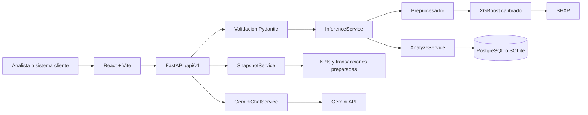

# Arquitectura del sistema

## Propósito

SentinelAI es una aplicación para evaluar transacciones financieras, priorizar
riesgo y ayudar a un analista a entender por qué el modelo tomó una decisión.
El repositorio contiene dos recorridos relacionados, pero separados:

- El pipeline científico entrena, evalúa y exporta artefactos de machine
	learning.
- La aplicación productiva carga esos artefactos y ejecuta inferencia mediante
	una API FastAPI y un dashboard React.

La API no entrena modelos durante una solicitud. El modelo, el preprocesador y
los contratos se cargan al iniciar el proceso y permanecen inmutables durante
su vida útil.

## Vista de componentes

## Flujo de arranque

`backend/app/main.py` crea la aplicación y, durante el lifespan:

1. Crea la base de datos y las tablas.
2. Inicializa autenticación y, si está configurado, el usuario bootstrap.
3. Carga el modelo, preprocesador, contrato de features y metadata.
4. Carga el snapshot y el parquet de transacciones del dashboard.
5. Registra los servicios en `app.state`.
6. Configura middlewares de trazabilidad, seguridad, cache, CORS y rate limit.
7. Expone métricas Prometheus si `EXPOSE_PROMETHEUS=true`.

Con `FAIL_FAST=true`, la aplicación no inicia si faltan artefactos o el
snapshot. En modo degradado puede iniciar, pero los endpoints que dependen de
esos recursos devuelven un error de servicio no disponible.

## Flujo de inferencia

El endpoint `POST /api/v1/analyze` sigue este recorrido:

1. `AnalyzeRequest` valida rangos, categorías y campos obligatorios.
2. `AnalyzeService` calcula un hash del payload cuando hay idempotencia.
3. `InferenceService` construye un `DataFrame` con las 18 features originales.
4. `ArtifactStore` aplica el preprocesador persistido.
5. XGBoost produce una probabilidad de fraude.
6. La probabilidad se convierte en score de 0 a 100 y nivel de riesgo.
7. SHAP obtiene las contribuciones de las features más importantes.
8. La decisión se persiste junto con su payload y auditoría.
9. Se devuelve la versión del modelo, el umbral calibrado y la explicación.

El artefacto actual es XGBoost Tier 2 con calibración isotónica. Su metadata
se encuentra en `backend/artifacts/model_metadata.json`; el contrato de
features está en `backend/artifacts/feature_contract.json`.

El umbral calibrado del artefacto es `0.247076`. El request también acepta
`decisionThreshold` para definir el bloqueo de esa solicitud. La respuesta
expone ambos conceptos: `blocked` refleja la solicitud evaluada y
`calibratedThreshold` identifica el umbral recomendado por el modelo.

## Persistencia

La capa de servicios depende de protocolos de repositorio, y
`SqlFraudRepository` implementa esos protocolos con SQLAlchemy. Esta separación
permite usar SQLite en desarrollo y PostgreSQL en despliegue sin cambiar la
lógica de inferencia.

Se almacenan:

- Decisiones y respuestas completas.
- Casos antifraude asociados de forma única a una decisión.
- Estado, asignación, veredicto y comentario de feedback humano.
- Notas de investigación de cada caso.
- Claves de idempotencia con expiración de 24 horas.
- Auditoría de solicitudes de análisis.
- Alertas de modelo.
- Usuarios y refresh tokens.

Las tablas se crean mediante SQLAlchemy y se actualizan con Alembic. El detalle
del esquema está en `docs/database_schema.md` y en `backend/app/db/models.py`.

## Dashboard y snapshot

`GET /api/v1/overview` usa `SnapshotService`. El servicio carga al inicio:

- `overview_snapshot.json` para KPIs, drift y ventana temporal.
- `overview_transactions.parquet` para filtros, ordenamiento y paginación.

Por eso el dashboard actual muestra una ventana de datos preparada, no una
consulta histórica completa de todas las decisiones almacenadas. Las nuevas
decisiones sí se guardan en la base de datos, pero todavía no alimentan
automáticamente los KPIs del snapshot.

## Autenticación y controles

Cuando `AUTH_ENABLED=true`, los endpoints protegidos usan cookies HttpOnly con
JWT de acceso y refresh tokens rotatorios. El refresh y logout requieren
validación CSRF. Las contraseñas se almacenan con Argon2 y los roles actuales
incluyen `admin` y `analyst`.

El frontend usa `credentials: "include"` y no almacena tokens en JavaScript.
El rate limit actual es de 60 análisis por minuto y 20 mensajes de chat por
minuto por proceso.

## Chat operativo

`POST /api/v1/chat` recibe el mensaje y hasta 12 mensajes de historial. El
backend llama a Gemini con `GEMINI_API_KEY`, manteniendo la clave fuera del
frontend. El asistente recibe instrucciones para responder en español y no
inventar información del dashboard.

Actualmente el chat no recibe automáticamente una decisión, una transacción o
los KPIs reales como contexto estructurado. Es un asistente de orientación
operativa, no todavía un investigador de casos conectado al expediente.

## Casos y feedback humano

`POST /api/v1/cases` abre un caso para una decisión existente. La decisión no
puede tener más de un caso. Los analistas pueden consultar y filtrar casos con
`GET /api/v1/cases`, obtener uno con `GET /api/v1/cases/{caseId}` y actualizarlo
con `PATCH /api/v1/cases/{caseId}`.

Los estados iniciales son `new`, `in_review`, `escalated` y `resolved`. Resolver
un caso exige un veredicto: `confirmed_fraud`, `false_positive` o
`inconclusive`. Los cambios y la apertura se registran en `audit_log`.

Esta primera vertical permite cerrar el ciclo básico de revisión, pero aún no
incluye adjuntos, escalamiento automático, SLA, colaboración entre equipos ni
retroalimentación automática al pipeline de entrenamiento.

## Eventos empresariales

Cada decisión persistida también crea un evento `decision.created` en la tabla
`outbox_events`, dentro de la misma transacción que la decisión y su auditoría.
El evento conserva el payload de la decisión, comienza en estado `pending` y
puede ser reclamado por un worker para publicarlo en Kafka, una cola o un
adaptador de proveedor externo. El estado pasa a `published` únicamente después
de que el transporte confirme la publicación.

Este outbox es la primera pieza de la integración empresarial: evita perder un
evento cuando la base de datos confirma una decisión pero el broker está caído.
Todavía no incluye un broker concreto, reintentos distribuidos ni consumidores;
esas piezas deben añadirse cuando se defina el proveedor de mensajería.

## Frontend

Las rutas React son `/`, `/analyzer`, `/models`, `/chat`, `/reports` y
`/settings`. El cliente HTTP central añade `/api/v1` a cada ruta relativa.
Por ello, las features deben invocar rutas como `/analyze`, `/models` o
`/chat`, nunca repetir el prefijo.

`VITE_USE_MOCKS=true` permite trabajar sin backend durante el desarrollo.
Para una compilación conectada a la API debe usarse `VITE_USE_MOCKS=false`.

## Límites actuales y evolución

El sistema actual no incluye todavía streaming de transacciones, reentrenamiento
automático, gestión avanzada de casos, rollback de modelos ni alertas externas.
La evolución recomendada es:

1. Conectar fuentes reales de transacciones.
2. Añadir adjuntos, SLA, escalamiento y colaboración al expediente.
3. Medir falsos positivos a partir del veredicto humano.
4. Implementar monitoreo real de drift y calidad de datos.
5. Versionar, validar y desplegar modelos con rollback.
6. Conectar el copiloto al contexto autorizado de cada caso.
